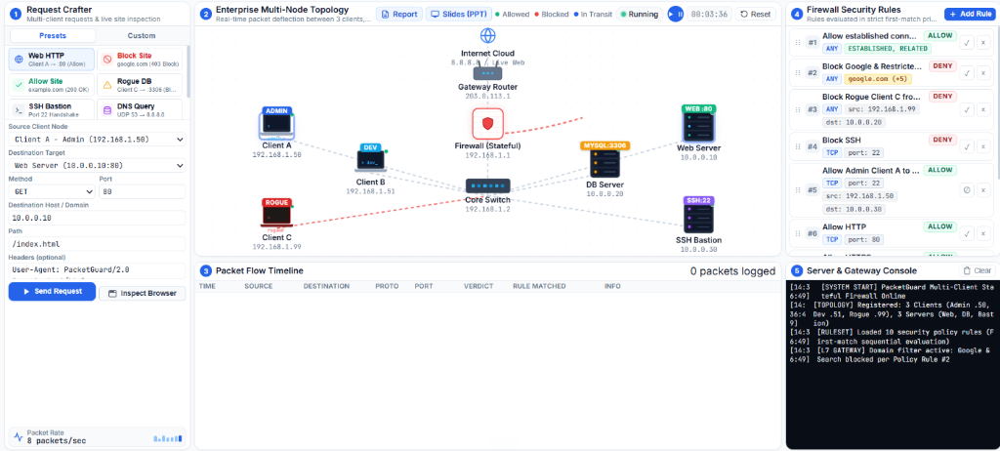

# 🛡️ PacketGuard
### Stateful Network Firewall Simulator

<div align="center">


**Interactive simulation of a Layer 3/4 Stateful Packet-Filtering Firewall with Layer 7 Domain Deflection for Computer Networks (CN).**

[Quick Start](#-quick-start) • [Topology](#️-network-architecture--topology) • [Demo Guide](#-interactive-demo-guide) • [Test Suite](#-test-suite--validation) • [Vercel Deploy](#️-deployment-to-vercel)



</div>

---

## 🌟 Executive Summary

In enterprise perimeter networks, firewalls are the foundational line of defense. **PacketGuard** bridges the gap between theoretical networking principles (RFC 791, RFC 793, RFC 1034) and practical cybersecurity software engineering. 

The system implements:
- **5-Tuple Packet Filtering**: Evaluates Source/Destination IPs, Ports, and Protocols with CIDR subnet matching (`/24`, `/8`, `/16`).
- **Stateful Connection Tracking (`conntrack`)**: Distinguishes `NEW`, `ESTABLISHED`, and `RELATED` sessions, automatically permitting return server traffic.
- **Enterprise Multi-Client Topology**: Segregates traffic between **Client A (Admin)**, **Client B (Developer)**, and **Client C (Rogue Host)**.
- **DMZ Server Tier & Bastion**: Defends an internal **Web Server (:80)**, **Database Server (:3306)**, and **SSH Bastion (:22)**.
- **Demonstrable L7 Domain Filtering**: Live interception showing blocking of `google.com` (403 Forbidden deflection) vs. allowed pass-through of `example.com` (200 OK).
- **Wireshark-Style Deep Packet Inspector**: Inspects encapsulated headers across Layer 2 (Ethernet), Layer 3 (IPv4), Layer 4 (TCP/UDP), and Layer 7 (Application Payload).

---

## 🏗️ Network Architecture & Topology

```
                              ┌─────────────────────────┐
                              │     Internet Cloud      │ (8.8.8.8 / Live Web)
                              └────────────┬────────────┘
                                           │
                              ┌────────────┴────────────┐
                              │     Gateway Router      │ (203.0.113.1)
                              └────────────┬────────────┘
                                           │
                              ┌────────────┴────────────┐
                              │   Firewall (Stateful)   │ (192.168.1.1) ──► [BLOCKED Deflection Arc]
                              └────────────┬────────────┘
                                           │
                              ┌────────────┴────────────┐
                              │       Core Switch       │ (192.168.1.2)
                              └───┬─────────────────┬───┘
         Enterprise LAN Clients   │                 │   Demilitarized Zone (DMZ) Servers
     ┌────────────────────────────┴─┐             ┌─┴────────────────────────────┐
     │  Client A - Admin (.50)      │             │  Web Server      (10.0.0.10) │
     │  Client B - Developer (.51)  │             │  Database Server (10.0.0.20) │
     │  Client C - Rogue Host (.99) │             │  SSH Bastion     (10.0.0.30) │
     └──────────────────────────────┘             └──────────────────────────────┘
```

---

## 🔬 Core Networking Concepts Implemented

### 1. The 5-Tuple & Protocol Dissection
Every network packet traversing the simulation model encapsulates an RFC-compliant 5-tuple:
1. **Source IP Address**: Internal client host (e.g., `192.168.1.50`)
2. **Destination IP Address / Domain**: Internal server or external FQDN (`10.0.0.10`, `google.com`, `8.8.8.8`)
3. **Source Port**: Ephemeral dynamic range (`49152`–`65535`)
4. **Destination Port**: Well-known service port (`80` HTTP, `443` HTTPS, `22` SSH, `53` DNS, `3306` MySQL)
5. **Transport Protocol**: `TCP`, `UDP`, or `ICMP`

### 2. First-Match Sequential Evaluation
Firewall rules are evaluated sequentially in descending order of priority (Rule #1, Rule #2, Rule #3...):
- The **first rule** that satisfies all matching criteria dictates the verdict (**ALLOW** or **DENY**).
- Evaluation halts immediately upon matching (short-circuit execution).
- Packets that do not match any explicit rule hit the **Default Policy: Deny All** (Zero-Trust baseline).

### 3. Stateful Connection Tracking (`conntrack`)
Traditional stateless packet filters evaluate every packet in isolation, forcing administrators to open high-range inbound ports. PacketGuard implements stateful inspection:
- When an outbound TCP handshake or UDP query is allowed, the session is registered in the firewall's `connectionTable`.
- Inbound return traffic (`HTTP 200 OK`, `TCP SYN-ACK`, `DNS Response`) automatically satisfies **Rule #1 (`ESTABLISHED, RELATED`)** and is admitted safely.

---

## 🕹️ Interactive Demo Guide

| Preset | Source ➔ Destination | Verdict | Educational Insight |
| :--- | :--- | :--- | :--- |
| **Web HTTP** | Client A ➔ Web Server (:80) | <span style="color:#10B981;font-weight:bold;">ALLOWED</span> | Matches Rule #3 (Allow HTTP). The web server responds with a 200 OK return packet via stateful conntrack Rule #1. |
| **Block Site** | Client A ➔ google.com (:443) | <span style="color:#EF4444;font-weight:bold;">BLOCKED</span> | Evaluates against Rule #2 (Block Restricted Sites). The firewall intercepts the packet, fires a red deflection arc, and renders a realistic 403 Forbidden intercept screen. |
| **Allow Site** | Client A ➔ example.com (:80) | <span style="color:#10B981;font-weight:bold;">ALLOWED</span> | Permitted through HTTP rules. The client browser inspects real HTTP headers and rendered payload. |
| **Rogue DB Probe** | Client C ➔ DB Server (:3306) | <span style="color:#EF4444;font-weight:bold;">BLOCKED</span> | Defends against untrusted internal nodes. Rogue host (192.168.1.99) is prevented from querying the internal database. |
| **SSH Bastion** | Client A ➔ Bastion (:22) | <span style="color:#EF4444;font-weight:bold;">BLOCKED</span> | Demonstrates default security posture. Port 22 SSH traffic is dropped per Rule #4 until explicit admin override is granted. |
| **DNS Query** | Client A ➔ Cloud DNS (8.8.8.8:53) | <span style="color:#10B981;font-weight:bold;">ALLOWED</span> | Routes UDP port 53 packets through Gateway Router to Internet Cloud, returning resolved DNS records. |
| **Port Scan** | Client A ➔ Nmap Sweep (6 Ports) | <span style="color:#F59E0B;font-weight:bold;">MIXED</span> | Sequentially sweeps ports 21, 22, 23, 80, 443, 3306, visually demonstrating open vs. closed ports. |
| **Custom Packet** | Custom 5-tuple payload | *Dynamic* | Craft custom source IPs, ports, HTTP verbs, paths, and headers. |

---

## 🧪 Test Suite & Validation

The core firewall engine is verified via an automated Node.js test suite (`test_suite.js`) executing 21 test assertions across Layer 3, Layer 4, and Layer 7:

```bash
npm test
```

### Output:
```
====================================================
   Running PacketGuard Firewall Engine Test Suite   
====================================================

  ✔ PASS [1] Web HTTP (Port 80) is ALLOWED by Rule #3 (Allow HTTP)
  ✔ PASS [2] Server HTTP 200 OK Return Packet is ALLOWED by Rule #1 (ESTABLISHED, RELATED)
  ✔ PASS [3] SSH (Port 22) is BLOCKED by Rule #2 (Block SSH)
  ✔ PASS [4] HTTPS (Port 443) is ALLOWED by Rule #4 (Allow HTTPS)
  ✔ PASS [5] DNS Query (Port 53, UDP) is ALLOWED by Rule #5 (Allow DNS)
  ✔ PASS [6] Database Query (Port 3306) is BLOCKED by Rule #7 (Default Deny All)
  ✔ PASS [7] Telnet (Port 23) is BLOCKED by Rule #6 (Block common attack ports)
  ✔ PASS [8] CIDR /24 includes internal host 192.168.1.50
  ✔ PASS [9] CIDR /24 excludes external host 192.168.2.50
  ✔ PASS [10] CIDR /8 includes host 10.0.5.22
  ✔ PASS [11] Port list matches 80
  ✔ PASS [12] Port list matches 443
  ✔ PASS [13] Port list rejects 8080
  ✔ PASS [14] Port range matches 5000
  ✔ PASS [15] Port range rejects privileged port 80
  ✔ PASS [16] Disabled Rule #2 is skipped during evaluation
  ✔ PASS [17] Custom Rule #2 (Allow SSH for Admins) now ALLOWS SSH traffic
  ✔ PASS [18] Domain google.com is BLOCKED by Rule (Block Google & Restricted Sites)
  ✔ PASS [19] Domain example.com is ALLOWED through HTTP Rule #3
  ✔ PASS [20] Rogue Client C (192.168.1.99) is BLOCKED from accessing DB (10.0.0.20)
  ✔ PASS [21] Client B (192.168.1.51) to Web Server (10.0.0.10:80) is ALLOWED

====================================================
   Test Results: 21/21 Tests Passed (100%)   
====================================================
```

---

## 🚀 Quick Start

### Method 1: Double-Click (Zero Setup)
Double-click `run.bat` in the repository root. It launches the local server and opens your browser automatically.

### Method 2: Node.js Dev Server
```bash
npm start
```
Runs a local static server serving the dashboard at `http://localhost:3000` or `http://localhost:5000`.

### Method 3: Python Backend (Optional Live HTTP Proxy)
```bash
python server.py
# Open: http://localhost:8000
```

### Method 4: Direct File Open
Simply double-click [`index.html`](index.html) in any modern browser (Chrome, Edge, Firefox, Brave, Safari).

---

## ☁️ Deployment to Vercel

The repository is configured for 1-click deployment on Vercel with included [`vercel.json`](vercel.json) security headers (`X-Content-Type-Options`, `X-Frame-Options`, `X-XSS-Protection`) and asset caching:

1. Visit **[vercel.com/new](https://vercel.com/new)**.
2. Select your repository: **`WillyEverGreen/CN_mini-project-`**.
3. Settings:
   - **Framework Preset**: `Other`
   - **Root Directory**: `./`
   - **Build Command**: *(leave empty)*
   - **Output Directory**: *(leave empty)*
4. Click **Deploy**. Your live simulator URL is ready in under 30 seconds!

---

## 📚 Academic Deliverables

- **[Live Simulator Dashboard](index.html)**: Interactive single-page GUI with real-time vector animation.
- **[Academic Project Report](report.html) ([Markdown](REPORT.md))**: University-grade 8,500-word comprehensive technical paper with RFC citations, conntrack diagrams, and print-to-PDF formatting.
- **[Slide Presentation Deck](presentation.html) ([Markdown](PRESENTATION.md))**: 10-slide interactive slide deck with keyboard navigation (`←` / `→`), speaker notes drawer, and fullscreen mode.
- **[Automated Test Runner](test_suite.js)**: 21 automated validation tests for lab evaluation.

---

## 🎓 Lab Viva & Examiner Q&A Guide

**Q1: What layers of the OSI model does PacketGuard operate at?**
> *Answer*: Primarily **Layer 3 (Network Layer)** for IP addresses/CIDR subnets and **Layer 4 (Transport Layer)** for TCP/UDP ports and flags. It also enforces **Layer 7 (Application Layer)** domain filtering.

**Q2: Why is the rule sequence critical in packet filtering?**
> *Answer*: Firewalls utilize **First-Match** semantics. If a permissive rule like `ALLOW ALL` is placed at Rule #1, subsequent drop rules (e.g., `Block SSH`) will never be evaluated. Specific deny rules must precede general allow rules.

**Q3: How does stateful connection tracking improve security over stateless filtering?**
> *Answer*: Stateless filters evaluate packets in isolation, requiring administrators to leave wide ephemeral inbound port ranges (`1024-65535`) open for replies. Stateful firewalls keep an in-memory session table; only inbound packets matching active outbound sessions are permitted.

**Q4: What is the difference between Default Allow and Default Deny?**
> *Answer*: **Default Allow (Blacklisting)** permits everything unless explicitly blocked, making it vulnerable to zero-day attacks. **Default Deny (Whitelisting / Zero-Trust)** blocks everything unless explicitly permitted, which is the industry standard security posture.

---

## 📄 License

This project is licensed under the **MIT License** — free for academic and educational usage.
